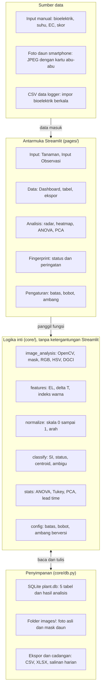

# Plant Stress Fingerprint: Perencanaan Proyek End to End

Tanggal: 2026-10-23

## Daftar Isi

1. Ringkasan Eksekutif
2. Tujuan, Ruang Lingkup, dan Metrik Keberhasilan
3. Pengguna dan Skenario Penggunaan
4. Desain Eksperimen dan Protokol Data
5. PRD: Kebutuhan Fungsional
6. PRD: Kebutuhan Non-Fungsional
7. Arsitektur Sistem
8. Desain Data dan Skema Database
9. Logika Inti dan Model Analitik
10. Desain Antarmuka dan Alur Pengguna
11. Antarmuka Modul dan Kontrak Fungsi
12. Rencana Pengujian dan Validasi
13. Keamanan, Privasi, dan Etika Data
14. Deployment dan Operasional
15. Rencana Kerja dan Jadwal
16. Risiko, Mitigasi, dan Keputusan Terbuka
17. Lampiran

---

## 1. Ringkasan Eksekutif

Plant Stress Fingerprint adalah aplikasi web berbasis Python (Streamlit) yang mengubah empat pengukuran murah pada daun cabai menjadi satu pola stres dan status peringatan dini: Normal, Warning, atau High Stress.

**Masalah.** Cekaman panas, salinitas, dan kekeringan pada cabai (*Capsicum annuum* L.) baru terlihat jelas setelah daun layu. Pada tahap itu kerusakan fisiologis sudah berjalan dan tindakan korektif kurang efektif. Alat ukur fisiologis yang ada umumnya mahal atau hanya mengukur satu aspek.

**Solusi.** Empat parameter diambil dari tanaman yang sama: potensial bioelektrik daun (mV), suhu daun (°C), warna daun dari foto smartphone (RGB/HSV), dan kebocoran elektrolit (EL, %). Semua nilai dinormalisasi ke skala 0 sampai 1, lalu dirangkum menjadi *fingerprint* per jenis cekaman. Data tanaman baru dicocokkan dengan fingerprint itu untuk menentukan tingkat dan jenis stres.

**Keluaran akhir.** Aplikasi yang mampu:

- menyimpan dan mengekspor data observasi terstandar,
- menganalisis foto daun secara otomatis (segmentasi, RGB, HSV, indeks warna),
- menampilkan radar chart dan heatmap per perlakuan,
- menjalankan uji statistik (ANOVA, uji lanjut Tukey, PCA),
- menghasilkan status peringatan dini beserta jenis cekaman terdekat untuk tanaman baru.

**Batas klaim.** Sistem mengenali pola dari tiga cekaman yang diuji pada kondisi percobaan sendiri. Klaim "sebelum layu" sah hanya bila data waktu menunjukkan peringatan muncul lebih awal daripada gejala layu pertama. Validasi pada tanaman independen wajib dilakukan sebelum hasilnya dipakai sebagai dasar keputusan budidaya.

| Keputusan | Pilihan | Alasan |
| --- | --- | --- |
| Framework | Streamlit (Python) | Satu bahasa untuk UI, citra, statistik, dan ML; MVP dalam 3 sampai 5 hari |
| Analisis citra | OpenCV | Segmentasi daun otomatis di ruang warna HSV, menggantikan ImageJ manual |
| Penyimpanan | SQLite lokal, ekspor CSV/XLSX | Cukup untuk skala percobaan, tanpa server |
| Model awal | Stress Index + centroid fingerprint | Mudah dijelaskan dan diaudit; ML menyusul bila data cukup |
| Jalur pengembangan | Logika inti di modul `core/` | Dapat dibungkus FastAPI dan dipakai frontend lain tanpa menulis ulang |

---

## 2. Tujuan, Ruang Lingkup, dan Metrik Keberhasilan

Proyek berhasil bila aplikasi mendeteksi pergeseran pola fisiologis cabai lebih awal daripada gejala layu, dengan alur kerja yang dapat diulang oleh satu peneliti di lapangan.

**Tujuan**

1. Menyediakan alur input terstandar untuk empat parameter fisiologis dan foto daun.
2. Mengotomatiskan ekstraksi warna daun dari foto agar tidak bergantung pada analisis manual.
3. Menghasilkan fingerprint per cekaman dan status peringatan untuk tanaman baru.
4. Menyediakan bukti statistik dan grafik yang siap masuk laporan atau naskah publikasi.

**Ruang lingkup**

| Termasuk (versi 1.0) | Tidak termasuk |
| --- | --- |
| Satu spesies: cabai (*Capsicum annuum* L.) | Spesies tanaman lain |
| Tiga cekaman (panas, salinitas, kekeringan) dan kontrol | Cekaman ganda sebagai kelas tersendiri (fase lanjut) |
| Input manual empat parameter dan unggah foto | Pembacaan sensor langsung secara real-time (data logger masuk lewat impor CSV) |
| Analisis citra OpenCV dengan pratinjau mask | Deteksi dari video, drone, atau kamera tetap |
| Normalisasi, radar chart, heatmap, ANOVA, PCA | Aplikasi native Android/iOS |
| Status peringatan dan jenis cekaman terdekat | Akun multi-pengguna dan manajemen peran |
| Ekspor CSV/XLSX dan pencadangan data | Rekomendasi tindakan agronomis otomatis |

**Metrik keberhasilan.** Semua target di bawah adalah target awal dan dikalibrasi ulang setelah data pilot tersedia.

| Metrik | Target awal | Cara ukur |
| --- | --- | --- |
| Waktu input satu observasi | 3 menit atau kurang | Uji stopwatch pada 10 observasi |
| Foto lolos segmentasi tanpa koreksi manual | 90% atau lebih | Pemeriksaan visual 50 foto uji |
| Akurasi pengenalan jenis cekaman | 80% atau lebih | Validasi silang per tanaman (leave-one-plant-out) |
| Lead time deteksi | Peringatan muncul minimal 1 hari sebelum layu pertama | Selisih hari peringatan dan hari layu pertama per tanaman |
| Alarm palsu pada kontrol | 10% atau kurang observasi kontrol berstatus Warning ke atas | Hitung pada seluruh data kontrol |
| Reproduksibilitas | Data dan konfigurasi sama menghasilkan keluaran identik | Uji regresi otomatis |

---

## 3. Pengguna dan Skenario Penggunaan

Pengguna utama adalah satu peneliti yang menjalankan percobaan, memasukkan data, dan menganalisis hasilnya; pengguna lain hanya membaca atau membantu input di lapangan.

| Peran | Kebutuhan utama | Perangkat |
| --- | --- | --- |
| Peneliti utama | Input data, analisis, kalibrasi, ekspor | Laptop dan HP |
| Asisten lapangan | Input observasi dan foto dengan cepat | HP |
| Pembimbing atau reviewer | Melihat grafik, tabel, dan bukti statistik | Laptop |

**Skenario harian di lapangan**

1. Ukur bioelektrik dan suhu daun pada jam yang sama setiap hari, lalu catat suhu udara.
2. Foto daun dengan kotak foto atau latar netral dan kartu abu-abu 18%.
3. Ambil sampel daun untuk uji EL, ukur EC1 dan EC2 sesuai protokol.
4. Buka halaman Input Observasi, isi nilai, unggah foto, periksa pratinjau mask, lalu simpan.
5. Lihat status yang muncul untuk tanaman tersebut dan catat bila gejala layu sudah terlihat.

**User stories dan kriteria penerimaan**

| ID | Sebagai peneliti, saya ingin | Kriteria penerimaan |
| --- | --- | --- |
| US-01 | Mendaftarkan tanaman beserta kelompok perlakuan | Kode tanaman unik; perlakuan dipilih dari empat opsi tetap |
| US-02 | Mengisi semua pengukuran dan foto dalam satu form | Nilai di luar rentang ditolak; EL terhitung otomatis |
| US-03 | Melihat hasil segmentasi daun sebelum menyimpan | Foto asli dan mask tampil berdampingan; ambang HSV dapat diubah |
| US-04 | Memfilter dan mengekspor data | Ekspor CSV/XLSX mengikuti filter yang sedang aktif |
| US-05 | Melihat radar chart dan heatmap per perlakuan | Sumbu 0 sampai 1; legenda dan label parameter jelas |
| US-06 | Menjalankan ANOVA, uji Tukey, dan PCA | Tabel p-value, kelompok huruf, dan plot PCA dengan varians terjelaskan |
| US-07 | Memasukkan data tanaman baru dan menerima status | Keluaran memuat Stress Index, status, dan dua fingerprint terdekat beserta jarak |
| US-08 | Mengatur batas min-max, bobot, dan ambang | Perubahan tersimpan sebagai versi konfigurasi bertanggal |
| US-09 | Melihat kurva parameter terhadap waktu dengan penanda hari layu | Grafik per perlakuan dengan garis hari layu pertama |

---

## 4. Desain Eksperimen dan Protokol Data

Kualitas keluaran aplikasi ditentukan oleh kualitas protokol pengukuran; aplikasi hanya menjaga konsistensi, bukan memperbaiki data yang diambil tidak seragam.

**Rancangan percobaan (usulan)**

| Elemen | Rencana |
| --- | --- |
| Perlakuan | Kontrol, panas, salinitas, kekeringan |
| Rancangan | Rancangan acak lengkap (RAL) |
| Ulangan | Minimal 5 tanaman per perlakuan (lebih baik 8 sampai 10 agar uji statistik dan validasi silang stabil) |
| Pengamatan | Hari 0 sebagai baseline, lalu setiap hari pada jam tetap hingga layu pertama atau akhir perlakuan |
| Data pembanding | Hari layu pertama per tanaman dan skor layu visual 0 sampai 4 |
| Tingkat cekaman | Ditetapkan dari literatur dan dicatat di tabel perlakuan (lihat keputusan terbuka) |

**Protokol per parameter**

| Parameter | Alat | Cara ukur | Kontrol kualitas |
| --- | --- | --- | --- |
| Bioelektrik (mV) | Multimeter atau data logger dengan elektroda daun | Pasang elektroda pada posisi daun yang sama, tunggu pembacaan stabil, ambil rata-rata 3 pembacaan | Daun ke-3 sampai ke-5 dari pucuk; catat posisi daun dan jarak elektroda |
| Suhu daun (°C) | Infrared thermometer | Jarak dan sudut tetap, permukaan atas daun, 3 pembacaan | Catat suhu udara pada saat yang sama untuk menghitung ΔT |
| Citra daun | Smartphone | Pencahayaan tetap, latar netral, jarak dan sudut tetap, eksposur dan white balance dikunci | Kartu abu-abu 18% di setiap foto; format JPEG kualitas tinggi tanpa filter |
| Integritas membran (EL) | Konduktometer | Rendam cakram daun berjumlah tetap; ukur EC1 setelah waktu rendam tetap, lalu EC2 setelah sampel dimatikan | EL = EC1 / EC2 × 100%; air bebas ion sebagai blanko |

**Catatan metodologis**

- Pengukuran EL merusak daun. Tetapkan jadwal dan posisi daun sampel agar luas daun tidak berkurang berlebihan dan catat setiap pengambilan.
- Observasi berulang pada tanaman yang sama tidak independen. Analisis statistik dan validasi model harus memperlakukan tanaman sebagai kelompok.
- Suhu daun dan bioelektrik berfluktuasi sepanjang hari; jam pengukuran harus dicatat dan dijaga konstan.
- Bioelektrik dapat merespons berbeda pada tiap cekaman; arah responsnya diputuskan dari data pilot, bukan diasumsikan.

---

## 5. PRD: Kebutuhan Fungsional

Versi 1.0 memuat 27 kebutuhan fungsional di tujuh modul; 16 berprioritas Must dan menjadi syarat rilis. Prioritas memakai MoSCoW: Must (wajib), Should (sebaiknya), Could (opsional).

| ID | Modul | Kebutuhan | Prioritas | Kriteria penerimaan |
| --- | --- | --- | --- | --- |
| FR-01 | Tanaman | Tambah, ubah, dan lihat tanaman (kode, perlakuan, tanggal tanam, tanggal mulai cekaman) | Must | Kode unik; perlakuan wajib |
| FR-02 | Tanaman | Impor daftar tanaman dari CSV | Could | Baris tidak valid dilaporkan, bukan diabaikan |
| FR-03 | Observasi | Form input: bioelektrik, suhu daun, suhu udara, EC1, EC2, skor layu, catatan | Must | Semua isian tersimpan dalam satu transaksi |
| FR-04 | Observasi | Hitung EL otomatis dari EC1 dan EC2 | Must | EL sama dengan perhitungan manual |
| FR-05 | Observasi | Validasi rentang dan konsistensi (EC1 tidak boleh melebihi EC2) | Must | Pesan galat menyebut field dan rentang |
| FR-06 | Observasi | Ubah dan hapus lunak dengan jejak perubahan | Should | Data lama tetap dapat dipulihkan |
| FR-07 | Observasi | Impor CSV data logger bioelektrik | Should | Pemetaan kolom dapat dipilih |
| FR-08 | Citra | Unggah foto daun (JPEG/PNG) dan simpan dengan nama terstruktur | Must | Foto terkait ke tepat satu observasi |
| FR-09 | Citra | Segmentasi daun otomatis di HSV dengan pratinjau mask | Must | Mask tampil di samping foto asli |
| FR-10 | Citra | Ekstraksi rata-rata R, G, B, H, S, V, DGCI, dan ExG | Must | Nilai cocok dengan perhitungan referensi pada foto uji |
| FR-11 | Citra | Koreksi eksposur memakai kartu abu-abu | Should | Selisih nilai antar-foto kartu abu-abu mengecil |
| FR-12 | Citra | Penyesuaian ambang HSV manual per foto | Should | Pratinjau mask diperbarui langsung |
| FR-13 | Data | Tabel observasi dengan filter perlakuan, tanaman, dan tanggal | Must | Filter menghasilkan jumlah baris yang benar |
| FR-14 | Data | Ekspor CSV dan XLSX | Must | File terbuka di Excel tanpa galat |
| FR-15 | Analisis | Normalisasi 0 sampai 1 dengan arah dan batas dari konfigurasi | Must | Nilai di luar batas dipotong ke 0 atau 1 |
| FR-16 | Analisis | Radar chart fingerprint per perlakuan | Must | Empat sumbu, rentang 0 sampai 1 |
| FR-17 | Analisis | Heatmap perlakuan × parameter | Must | Skala warna dan nilai terbaca |
| FR-18 | Analisis | ANOVA satu arah dan uji lanjut Tukey per parameter | Should | Hasil sama dengan perangkat lunak statistik pembanding |
| FR-19 | Analisis | PCA dengan plot dua komponen | Could | Varians terjelaskan ditampilkan |
| FR-20 | Analisis | Kurva parameter terhadap hari dengan penanda hari layu | Should | Rata-rata dan galat baku per perlakuan |
| FR-21 | Fingerprint | Hitung centroid per perlakuan dari data terpilih | Must | Centroid dapat diekspor |
| FR-22 | Fingerprint | Hitung Stress Index dan status Normal, Warning, High Stress | Must | Status sesuai ambang konfigurasi |
| FR-23 | Fingerprint | Cari dua perlakuan terdekat beserta jarak dan tanda "pola ambigu" | Must | Ambigu bila selisih jarak kecil |
| FR-24 | Fingerprint | Aturan persistensi: status naik setelah 2 observasi berurutan | Should | Aturan dapat dinyalakan dan dimatikan |
| FR-25 | Fingerprint | Latih kNN atau Random Forest dengan validasi silang per tanaman | Could | Akurasi dan confusion matrix tampil |
| FR-26 | Pengaturan | Atur batas min-max, arah, bobot, dan ambang dengan versi konfigurasi | Must | Setiap hasil menyimpan ID konfigurasi |
| FR-27 | Pengaturan | Log audit perubahan konfigurasi dan data | Should | Waktu dan ringkasan perubahan tercatat |

---

## 6. PRD: Kebutuhan Non-Fungsional

Tiga prioritas non-fungsional adalah konsistensi hasil (reproduksibilitas), kemudahan input di lapangan, dan integritas data; sisanya mengikuti skala percobaan satu peneliti.

| Kategori | Kebutuhan | Target |
| --- | --- | --- |
| Reproduksibilitas | Setiap hasil menyimpan ID konfigurasi dan versi aplikasi; seed tetap pada model ML; dependensi dikunci versinya | Data dan konfigurasi sama menghasilkan keluaran identik |
| Kinerja | Analisis satu foto dengan sisi terpanjang diperkecil ke 1.600 px | 2 detik atau kurang per foto; halaman analisis 3 detik atau kurang untuk 2.000 observasi |
| Kegunaan | Tata letak responsif untuk HP, bahasa Indonesia, satuan tampil di setiap label | Form input maksimal 8 isian dan 1 foto; tanpa pelatihan khusus |
| Aksesibilitas | Status tidak hanya dibedakan warna, tetapi juga teks dan ikon | Semua status terbaca tanpa persepsi warna |
| Keandalan | Transaksi atomik pada penyimpanan observasi; pesan galat yang dapat ditindaklanjuti | Tidak ada data setengah tersimpan |
| Integritas data | Hapus lunak, log audit, pencadangan otomatis | Pemulihan data hingga cadangan terakhir |
| Portabilitas | Berjalan lokal di Windows, macOS, dan Linux; Docker opsional | Python 3.11 atau lebih baru |
| Pemeliharaan | Logika inti terpisah dari UI, pengetikan tipe, linter, dan uji unit | Cakupan uji 80% atau lebih untuk modul `core/` |
| Keterbukaan | Seluruh rumus dan ambang terdokumentasi dan dapat ditelusuri dari antarmuka | Halaman Pengaturan menampilkan rumus yang dipakai |

---

## 7. Arsitektur Sistem

Arsitektur terdiri dari empat lapisan: sumber data, antarmuka Streamlit, logika inti (`core/`), dan penyimpanan; hanya `core/` yang memuat aturan ilmiah, sehingga UI dan penyimpanan dapat diganti tanpa mengubah hasil perhitungan.



Data mengalir dari atas ke bawah: input dan foto masuk lewat halaman Streamlit, halaman memanggil fungsi di `core/`, dan hanya `core/db.py` yang membaca atau menulis penyimpanan. Pada mode online, hanya `core/db.py` yang diganti (Supabase atau Google Sheets); UI dan logika tetap.

| Lapisan | Teknologi | Alasan |
| --- | --- | --- |
| Antarmuka | Streamlit (multipage) | Cepat dibangun, cukup untuk alat riset satu pengguna |
| Analisis citra | OpenCV dan Pillow | Segmentasi HSV otomatis, ekstraksi warna, koreksi eksposur |
| Data dan hitung | pandas dan numpy | Normalisasi dan agregasi per perlakuan |
| Grafik | Plotly | Radar chart dan heatmap interaktif |
| Statistik dan ML | scipy, statsmodels, scikit-learn | ANOVA, Tukey, PCA, kNN dan Random Forest dengan validasi silang |
| Penyimpanan | SQLite (lokal); Supabase atau Google Sheets (online) | Sederhana untuk skala percobaan; mudah dipindah lewat `core/db.py` |
| Pengujian | pytest | Uji unit, integrasi, dan regresi |

**Prinsip arsitektur**

1. Fungsi di `core/` murni: tidak memanggil Streamlit, tidak membaca jam sistem, dan menerima konfigurasi sebagai argumen.
2. Akses basis data hanya melalui `core/db.py`.
3. Setiap hasil analisis menyimpan `config_id` agar dapat direproduksi.
4. Jalur pengembangan ke produk: `core/` dibungkus FastAPI, lalu frontend lain memanggilnya tanpa menulis ulang rumus.

---

## 8. Desain Data dan Skema Database

Basis data memakai lima tabel: satu tanaman memiliki banyak observasi, satu observasi memiliki satu atau lebih foto dan satu hasil analisis per versi konfigurasi.

| Tabel | Isi | Relasi |
| --- | --- | --- |
| `plants` | Identitas tanaman, perlakuan, tanggal tanam, mulai cekaman, layu pertama | Induk dari `observations` |
| `observations` | Nilai pengukuran dan skor layu pada satu waktu | Anak `plants`; induk `leaf_images` dan `analysis_results` |
| `leaf_images` | Path foto, nilai warna, ambang HSV yang dipakai | Anak `observations` |
| `config_versions` | Batas min-max, arah, bobot, ambang dalam format JSON | Dirujuk `analysis_results` |
| `analysis_results` | Nilai ternormalisasi, Stress Index, status, perlakuan terdekat | Anak `observations` dan `config_versions` |

```sql
CREATE TABLE plants (
  id INTEGER PRIMARY KEY,
  code TEXT UNIQUE NOT NULL,
  treatment TEXT NOT NULL CHECK (treatment IN ('kontrol','panas','salinitas','kekeringan')),
  planted_at DATE,
  stress_started_at DATE,
  first_wilt_at DATE,
  notes TEXT
);

CREATE TABLE observations (
  id INTEGER PRIMARY KEY,
  plant_id INTEGER NOT NULL REFERENCES plants(id),
  observed_at TIMESTAMP NOT NULL,
  day_after_treatment INTEGER,
  bioelectric_mv REAL,
  leaf_temp_c REAL,
  air_temp_c REAL,
  ec1_us REAL,
  ec2_us REAL,
  el_percent REAL,
  wilt_score INTEGER CHECK (wilt_score BETWEEN 0 AND 4),
  notes TEXT,
  deleted_at TIMESTAMP,
  UNIQUE (plant_id, observed_at)
);

CREATE TABLE leaf_images (
  id INTEGER PRIMARY KEY,
  observation_id INTEGER NOT NULL REFERENCES observations(id),
  file_path TEXT NOT NULL,
  r REAL, g REAL, b REAL,
  h REAL, s REAL, v REAL,
  dgci REAL, exg REAL,
  leaf_pixels INTEGER,
  hsv_low TEXT, hsv_high TEXT,
  has_gray_card INTEGER DEFAULT 0
);

CREATE TABLE config_versions (
  id INTEGER PRIMARY KEY,
  created_at TIMESTAMP NOT NULL,
  note TEXT,
  settings_json TEXT NOT NULL
);

CREATE TABLE analysis_results (
  id INTEGER PRIMARY KEY,
  observation_id INTEGER NOT NULL REFERENCES observations(id),
  config_id INTEGER NOT NULL REFERENCES config_versions(id),
  norm_bio REAL, norm_temp REAL, norm_color REAL, norm_el REAL,
  stress_index REAL,
  status TEXT CHECK (status IN ('Normal','Warning','High Stress')),
  nearest_treatment TEXT, nearest_distance REAL,
  second_treatment TEXT, second_distance REAL
);
```

**Aturan validasi**

| Field | Aturan | Jenis |
| --- | --- | --- |
| `leaf_temp_c`, `air_temp_c` | 10 sampai 60 °C | Keras (ditolak) |
| `ec1_us`, `ec2_us` | Lebih dari 0; EC1 tidak boleh melebihi EC2 | Keras |
| `wilt_score` | Bilangan bulat 0 sampai 4 | Keras |
| `bioelectric_mv` | Rentang ditetapkan dari data pilot; sementara, peringatan bila di luar rata-rata ± 4 simpangan baku | Lunak (peringatan) |
| Foto | Piksel daun minimal 500 setelah segmentasi | Keras |
| Kombinasi `plant_id` dan `observed_at` | Unik | Keras |

Skala skor layu (0 tidak ada gejala sampai 4 layu berat) adalah usulan dan perlu didefinisikan tertulis sebelum pengamatan dimulai. Kolom turunan seperti ΔT (suhu daun dikurangi suhu udara) dihitung saat analisis dan tidak disimpan agar tidak ganda.

---

## 9. Logika Inti dan Model Analitik

Model awal sengaja sederhana: nilai ternormalisasi dirata-ratakan menjadi Stress Index untuk menentukan tingkat stres, dan jarak ke centroid menentukan jenis stres.

**Alur perhitungan untuk satu observasi**

1. Hitung fitur: EL, ΔT, dan indeks warna (DGCI) dari foto.
2. Normalisasi tiap fitur ke 0 sampai 1 memakai batas dan arah dari versi konfigurasi aktif.
3. Hitung Stress Index sebagai rata-rata berbobot.
4. Tentukan status dari ambang konfigurasi.
5. Hitung jarak ke centroid tiap perlakuan, ambil dua terdekat, dan beri tanda ambigu bila selisihnya kecil.
6. Terapkan aturan persistensi dan penanda kualitas data.
7. Simpan hasil beserta ID konfigurasi.

**Rumus**

$$EL = \frac{EC_1}{EC_2} \times 100$$

$$\Delta T = T_{daun} - T_{udara}$$

$$DGCI = \frac{\frac{H - 60}{60} + (1 - S) + (1 - V)}{3}$$

H dalam derajat (0 sampai 360), S dan V dalam skala 0 sampai 1. Nilai DGCI turun saat daun menguning, sehingga arah normalisasinya dibalik.

$$z_j = \mathrm{clip}\left(\frac{x_j - \min_j}{\max_j - \min_j},\, 0,\, 1\right), \qquad z_j \leftarrow 1 - z_j \ \text{(arah turun)}$$

$$SI = \frac{\sum_j w_j\, z_j}{\sum_j w_j}$$

$$d_k = \sqrt{\sum_j (z_j - c_{kj})^2}, \qquad \text{ambigu bila } \frac{d_{(2)} - d_{(1)}}{d_{(2)}} < \delta$$

**Parameter normalisasi (nilai awal, dikalibrasi dari data pilot)**

| Parameter | Fitur | Arah | Batas bawah | Batas atas |
| --- | --- | --- | --- | --- |
| Bioelektrik | Deviasi mutlak dari baseline kontrol (atau nilai langsung, diputuskan dari pilot) | Naik | Rata-rata kontrol | Persentil 95 seluruh data |
| Suhu daun | ΔT | Naik | Rata-rata kontrol | Persentil 95 seluruh data |
| Warna daun | DGCI | Turun | Persentil 5 seluruh data | Rata-rata kontrol |
| Integritas membran | EL (%) | Naik | Rata-rata kontrol | Persentil 95 seluruh data |

**Kalibrasi ambang status**

- Warning: persentil 95 Stress Index pada data kontrol, sehingga alarm palsu pada kontrol sekitar 5%.
- High Stress: titik potong terbaik yang memisahkan kontrol dari observasi pada hari layu pertama, dipilih dari kurva ROC (indeks Youden).
- Placeholder 0,33 dan 0,66 dipakai hanya untuk menguji alur sebelum data pilot ada, bukan untuk melaporkan hasil.

**Aturan menekan alarm palsu**

- Persistensi: status naik hanya setelah 2 observasi berurutan melewati ambang.
- Penjaga satu parameter: satu nilai ternormalisasi di atas 0,8 minimal memunculkan Warning.
- Pola ambigu: bila dua perlakuan hampir sama dekat, tampilkan keduanya dan jangan menyebut satu jenis cekaman.
- Data tidak valid: foto gagal segmentasi atau nilai di luar batas keras tidak dihitung, status ditampilkan sebagai "Data tidak valid".

**Tahap model**

| Tahap | Metode | Syarat masuk |
| --- | --- | --- |
| 1 | Stress Index dan centroid | Langsung dipakai pada versi 1.0 |
| 2 | kNN atau Random Forest | Minimal 30 sampai 40 observasi dan 8 tanaman per kelas; validasi silang dikelompokkan per tanaman |
| 3 | Model berbasis waktu (tren atau mixed-effects) | Opsional, bila data harian cukup panjang |

Batas normalisasi dan centroid dihitung hanya dari data latih pada tiap lipatan validasi, agar akurasi tidak terlalu optimistis.

**Pembuktian klaim "sebelum layu"**

Untuk tiap parameter dan Stress Index, bandingkan tiap perlakuan dengan kontrol pada setiap hari memakai uji Welch dengan koreksi Holm, atau model campuran bila memungkinkan. Hari pertama yang berbeda nyata dibandingkan dengan hari layu pertama per tanaman; selisihnya adalah lead time deteksi yang dilaporkan.

---

## 10. Desain Antarmuka dan Alur Pengguna

Antarmuka terdiri dari tujuh halaman, dengan halaman Input Observasi sebagai yang paling sering dipakai dan dirancang untuk layar HP.

| Halaman | Tujuan | Komponen utama |
| --- | --- | --- |
| Dashboard | Ringkasan kondisi percobaan | Jumlah tanaman dan observasi, observasi terbaru, sebaran status per perlakuan |
| Tanaman | Kelola tanaman dan perlakuan | Tabel tanaman, form tambah, kolom tanggal mulai cekaman dan layu pertama |
| Input Observasi | Catat satu observasi | Form pengukuran, unggah foto, pratinjau mask, EL otomatis |
| Data | Telusuri dan ekspor | Tabel dengan filter, tombol ekspor CSV dan XLSX |
| Analisis | Pola dan statistik | Normalisasi, radar chart, heatmap, kurva waktu, ANOVA, PCA |
| Fingerprint dan Peringatan | Periksa tanaman baru | Input empat nilai atau pilih observasi, status, perlakuan terdekat, radar pembanding |
| Pengaturan | Kalibrasi | Batas min-max, arah, bobot, ambang, riwayat versi konfigurasi |

**Sketsa halaman Input Observasi** (angka hanya contoh tampilan)

```text
+--------------------------------------------------------+
| Input Observasi                                        |
| Tanaman [ C-03 v ]        Tanggal dan jam [ 2026-.. ]  |
|--------------------------------------------------------|
| Bioelektrik (mV) [____]   Suhu daun (°C)   [____]      |
| Suhu udara (°C)  [____]   EC1 (µS/cm)      [____]      |
| EC2 (µS/cm)      [____]   Skor layu (0-4)  [ 0 v]      |
|--------------------------------------------------------|
| Foto daun  [ Pilih atau ambil foto ]                   |
| [ foto asli ]   [ mask daun ]   R G B / H S V / DGCI   |
| Ambang HSV  H [25-95]  S [40-255]  V [40-255]          |
|--------------------------------------------------------|
| EL otomatis: 34,2 %           [ Simpan observasi ]     |
+--------------------------------------------------------+
```

**Sketsa halaman Fingerprint dan Peringatan**

```text
+--------------------------------------------------------+
| Fingerprint dan Peringatan                             |
|--------------------------------------------------------|
|  Radar chart                | Status: [ HIGH STRESS ]  |
|  tanaman ini                | Stress Index: 0,70       |
|  vs fingerprint referensi   | Terdekat: Panas (0,16)   |
|                             | Kedua:  Kekeringan (0,51)|
|                             | Pola: jelas              |
|--------------------------------------------------------|
| Tabel nilai ternormalisasi: bio | suhu | warna | EL    |
+--------------------------------------------------------+
```

**Alur pengguna utama**

1. Pilih tanaman, isi nilai pengukuran, unggah foto.
2. Periksa mask daun; ubah ambang HSV bila ada area bukan daun yang ikut terhitung.
3. Simpan observasi; aplikasi menghitung EL, warna, normalisasi, dan status.
4. Lihat status di halaman Fingerprint; periksa tren pada halaman Analisis.
5. Ekspor data atau grafik untuk laporan.

**Prinsip tampilan**

- Status memakai tiga tingkat dengan teks dan ikon, tidak hanya warna: Normal (hijau), Warning (kuning), High Stress (merah).
- Label selalu menyertakan satuan; nilai di luar rentang ditandai dan dijelaskan.
- Radar chart memiliki empat sumbu (belah ketupat), sesuai jumlah parameter.

---

## 11. Antarmuka Modul dan Kontrak Fungsi

Semua logika berada di paket `core/` tanpa ketergantungan pada Streamlit, sehingga setiap fungsi dapat diuji terpisah dan dipanggil ulang oleh API atau frontend lain di kemudian hari.

| Modul | Fungsi | Masukan | Keluaran |
| --- | --- | --- | --- |
| `core/image_analysis.py` | `analyze_leaf(img, hsv_low, hsv_high)` | Citra BGR, ambang HSV | Dict: r, g, b, h, s, v, dgci, exg, leaf_pixels, mask |
| `core/image_analysis.py` | `correct_exposure(img, card_roi)` | Citra, area kartu abu-abu | Citra terkoreksi |
| `core/features.py` | `compute_features(obs, image_stats)` | Baris observasi, hasil citra | EL, ΔT, DGCI |
| `core/normalize.py` | `normalize(df, cfg)` | Tabel fitur, konfigurasi | Tabel nilai 0 sampai 1 |
| `core/classify.py` | `stress_index(row, weights)` | Satu baris ternormalisasi, bobot | Bilangan 0 sampai 1 |
| `core/classify.py` | `status(si, warn, high)` | Stress Index, ambang | Normal, Warning, atau High Stress |
| `core/classify.py` | `nearest(row, centroids, delta)` | Baris, centroid, ambang ambigu | Dua perlakuan terdekat, jarak, tanda ambigu |
| `core/classify.py` | `apply_persistence(history, n)` | Riwayat status tanaman, n | Status akhir setelah aturan persistensi |
| `core/stats.py` | `anova_tukey(df, col)` | Tabel, nama kolom | Tabel F, p-value, kelompok Tukey |
| `core/stats.py` | `first_significant_day(df, col)` | Tabel, kolom | Hari pertama beda nyata dari kontrol |
| `core/stats.py` | `pca(df)` | Tabel ternormalisasi | Skor, varians terjelaskan |
| `core/db.py` | `save_observation(...)`, `list_observations(filter)`, `export(...)` | Data atau filter | Baris tersimpan, tabel, file ekspor |
| `core/config.py` | `load_active()`, `save_new(settings, note)` | Pengaturan | Versi konfigurasi aktif atau baru |

**Contoh keluaran prediksi**

Fingerprint referensi pada contoh ini memakai skor dari gambar skema (panas [5,5,2,4], salinitas [4,3,5,5], kekeringan [3,4,3,3], kontrol [1,1,1,1]) yang diubah ke skala 0 sampai 1 dengan rumus (skor − 1) / 4.

```json
{
  "norm": {"bioelectric": 0.9, "leaf_temp_delta": 0.9, "color": 0.3, "el": 0.7},
  "stress_index": 0.70,
  "status": "High Stress",
  "nearest": [
    {"treatment": "panas", "distance": 0.16},
    {"treatment": "kekeringan", "distance": 0.51}
  ],
  "ambiguous": false,
  "config_id": 1
}
```

Kontrak yang harus dijaga: fungsi bersifat deterministik, tidak membaca berkas atau jam sistem secara langsung, dan selalu menerima konfigurasi sebagai argumen.

---

## 12. Rencana Pengujian dan Validasi

Pengujian dibagi dua kelompok: kebenaran perangkat lunak (apakah rumus dan alur benar) dan kebenaran ilmiah (apakah pola benar-benar memisahkan cekaman dan muncul sebelum layu).

| Level | Yang diuji | Cara | Kriteria lolos |
| --- | --- | --- | --- |
| Unit | EL, ΔT, DGCI, normalisasi, Stress Index, jarak centroid | pytest dengan nilai hitung tangan, termasuk kasus batas (nilai di bawah min, di atas max, pembagi nol) | Semua uji lolos; cakupan `core/` 80% atau lebih |
| Citra | Segmentasi dan ekstraksi warna | Set uji 50 foto dengan mask manual; bandingkan irisan terhadap gabungan (IoU) dan selisih nilai warna | IoU rata-rata 0,9 atau lebih; 90% foto lolos tanpa koreksi manual |
| Integrasi | Alur input hingga hasil tersimpan | Skrip yang memasukkan 20 observasi sintetis lalu memeriksa tabel hasil | Hasil identik dengan perhitungan referensi |
| Statistik | ANOVA, Tukey, PCA | Bandingkan dengan keluaran R atau SPSS pada data yang sama | Selisih p-value di bawah 0,001 |
| Regresi | Keluaran tetap saat kode berubah | Simpan keluaran referensi, bandingkan pada setiap perubahan | Tidak ada perbedaan tanpa alasan tercatat |
| Kegunaan | Kecepatan dan kejelasan form | Uji dengan 2 sampai 3 orang di lapangan | Input 3 menit atau kurang, tanpa pertanyaan tentang satuan |
| Ilmiah | Akurasi jenis cekaman | Validasi silang yang dikelompokkan per tanaman; confusion matrix | Akurasi 80% atau lebih (target awal) |
| Ilmiah | Lead time deteksi | Hari pertama beda nyata dibandingkan hari layu pertama | Peringatan minimal 1 hari lebih awal |
| Ilmiah | Alarm palsu | Hitung proporsi observasi kontrol berstatus Warning ke atas | 10% atau kurang |
| Ilmiah | Ketahanan terhadap foto | Foto ulang daun yang sama pada pencahayaan sedikit berbeda | Selisih indeks warna di bawah ambang yang ditetapkan dari pilot |

**Validasi independen.** Sisihkan sebagian tanaman (misalnya 2 dari tiap perlakuan) yang tidak dipakai untuk kalibrasi batas dan ambang, lalu uji model pada tanaman tersebut. Hasilnya dilaporkan terpisah sebagai bukti generalisasi.

**Daftar periksa rilis v1.0**

- [ ] Semua kebutuhan Must (FR) lolos kriteria penerimaan
- [ ] Uji unit, integrasi, dan regresi hijau
- [ ] Set uji citra memenuhi target IoU
- [ ] Konfigurasi hasil kalibrasi tersimpan sebagai versi aktif
- [ ] Validasi silang dan validasi independen tercatat
- [ ] Cadangan dan pemulihan data sudah dicoba satu kali
- [ ] README, SOP foto, dan SOP pengukuran selesai

---

## 13. Keamanan, Privasi, dan Etika Data

Risiko keamanan rendah karena data bukan data pribadi; fokus utamanya adalah integritas data penelitian dan perlindungan akses bila aplikasi dipublikasikan online.

| Aspek | Kebijakan |
| --- | --- |
| Data pribadi | Tidak ada; foto hanya memuat tanaman, tanpa wajah atau lokasi tepat. Metadata EXIF (GPS) dihapus saat unggah |
| Akses | Mode lokal tanpa login. Mode online wajib kata sandi (misalnya streamlit-authenticator) dan hanya untuk peneliti |
| Rahasia | Kunci API dan kredensial disimpan di variabel lingkungan atau `secrets`, tidak masuk repositori |
| Unggahan | Hanya JPEG dan PNG, batas ukuran 15 MB, nama file dibuat ulang oleh sistem |
| Integritas | Hapus lunak, log audit, dan versi konfigurasi pada setiap hasil |
| Pencadangan | Aturan 3-2-1: tiga salinan, dua media, satu di luar lokasi (misalnya Google Drive); ekspor CSV mingguan |
| Etika penelitian | Outlier tidak dihapus tanpa alasan tertulis; data mentah dipertahankan dan semua perlakuan data tercatat |
| Lisensi | Pustaka memakai lisensi terbuka; lisensi kode proyek ditentukan sebelum dipublikasikan |

---

## 14. Deployment dan Operasional

Versi 1.0 dijalankan lokal di laptop dengan SQLite; publikasi online baru dilakukan bila ada kebutuhan akses dari HP tanpa laptop, dan saat itu penyimpanan harus dipindah dari berkas lokal.

| Lingkungan | Konfigurasi | Penyimpanan | Catatan |
| --- | --- | --- | --- |
| Lokal (utama) | `streamlit run app.py` di virtual environment Python 3.11+ | SQLite dan folder `data/images/` | Paling sederhana; akses HP lewat jaringan Wi-Fi yang sama |
| Online | Streamlit Community Cloud atau VPS kecil | Supabase (Postgres dan Storage) atau Google Sheets lewat `gspread` | SQLite pada Community Cloud tidak permanen dan hilang saat aplikasi dimulai ulang |
| Kontainer (opsional) | Docker dengan `requirements.txt` terkunci | Volume untuk `data/` | Memudahkan pindah komputer dan mereproduksi lingkungan |

**Operasional**

- Versi: Git dengan tag semantik (v1.0.0), catatan perubahan pada setiap rilis.
- Konfigurasi: `config/settings.yaml` untuk nilai awal; versi aktif di tabel `config_versions`.
- Cadangan: salin harian berkas basis data dan folder foto; ekspor CSV mingguan ke penyimpanan awan.
- Pemantauan: log aplikasi ke berkas dengan rotasi; peringatan bila gagal menyimpan.
- Migrasi: skrip migrasi skema bernomor agar basis data lama dapat ditingkatkan tanpa kehilangan data.

**Langkah rilis**

1. Jalankan seluruh uji dan periksa daftar periksa rilis.
2. Bekukan konfigurasi hasil kalibrasi sebagai versi aktif.
3. Ekspor cadangan penuh dan uji pemulihan.
4. Beri tag versi dan simpan dokumen hasil validasi.
5. Salin ke lingkungan target dan jalankan uji asap (satu observasi uji dari awal sampai akhir).

---

## 15. Rencana Kerja dan Jadwal

Rencana kerja berjalan dalam enam fase selama sekitar enam minggu, dan tiap fase ditutup oleh satu gerbang mutu yang harus lolos sebelum fase berikutnya dimulai.

| Fase | Minggu | Deliverable | Definition of done (gerbang mutu) |
| --- | --- | --- | --- |
| 0. Persiapan | 1 | SOP foto dan pengukuran, keputusan terbuka (bagian 16) dijawab, repositori dan templat data | SOP diuji pada 3 tanaman percobaan; keputusan tingkat cekaman dan jumlah ulangan tercatat |
| 1. Fondasi data | 1 sampai 2 | Skema SQLite, form input, tabel data, ekspor | FR-01, FR-03 sampai FR-05, FR-13, FR-14 lolos; 10 observasi uji tersimpan dan terekspor |
| 2. Analisis citra | 2 sampai 3 | Modul OpenCV, pratinjau mask, set uji 50 foto | FR-08 sampai FR-10 lolos; IoU rata-rata 0,9 atau lebih; 90% foto lolos tanpa koreksi |
| 3. Fingerprint | 3 sampai 4 | Normalisasi, radar chart, heatmap, Stress Index, status, halaman peringatan | FR-15 sampai FR-17 dan FR-21 sampai FR-23 lolos; hasil sama dengan perhitungan tangan |
| 4. Pilot dan kalibrasi | 4 sampai 5 | Data pilot, batas min-max, arah bioelektrik, ambang status, statistik awal | Konfigurasi hasil kalibrasi tersimpan; alarm palsu pada kontrol 10% atau kurang |
| 5. Validasi dan rilis | 6 | Validasi silang dan independen, ANOVA, PCA, dokumentasi, rilis v1.0 | Seluruh daftar periksa rilis (bagian 12) tercentang |

Pengumpulan data percobaan berjalan paralel sejak fase 2 dan menyuplai data pilot untuk fase 4; durasi per fase menyesuaikan jadwal percobaan sebenarnya.

---

## 16. Risiko, Mitigasi, dan Keputusan Terbuka

Risiko terbesar bersifat ilmiah, bukan teknis: ukuran sampel kecil dan foto yang tidak konsisten dapat membuat fingerprint terlihat bagus tetapi tidak berlaku pada tanaman baru.

| Risiko | Dampak | Peluang | Mitigasi |
| --- | --- | --- | --- |
| Ulangan terlalu sedikit | Fingerprint tidak stabil, uji statistik lemah | Tinggi | Minimal 5 tanaman per perlakuan, target 8 sampai 10; validasi silang per tanaman |
| Pencahayaan foto tidak konsisten | Nilai warna tidak dapat dibandingkan antar hari | Tinggi | Kotak foto, kartu abu-abu 18%, eksposur dikunci, koreksi eksposur di aplikasi |
| Segmentasi gagal pada daun menguning atau berbayang | Nilai warna bias | Sedang | Pratinjau mask wajib, ambang HSV dapat diubah, set uji 50 foto |
| Respons bioelektrik tidak searah antar cekaman | Normalisasi salah arah | Sedang | Tentukan arah dari data pilot; sediakan opsi deviasi mutlak |
| Kebocoran data pada validasi (observasi tanaman sama di data latih dan uji) | Akurasi terlalu optimistis | Sedang | Validasi dikelompokkan per tanaman; tanaman cadangan untuk uji independen |
| EL merusak daun | Mengurangi luas daun, memengaruhi pengukuran lain | Sedang | Jadwal sampel terbatas, catat posisi daun, pakai daun pembanding yang konsisten |
| Cekaman ganda di lapangan | Pola tidak cocok dengan fingerprint tunggal | Sedang | Tampilkan dua perlakuan terdekat dan tanda ambigu; cekaman ganda masuk fase lanjut |
| Data hilang pada hosting online | Kehilangan data percobaan | Sedang | SQLite hanya untuk lokal; online memakai Supabase atau Sheets; cadangan 3-2-1 |
| Jadwal percobaan dan pengembangan bertabrakan | Aplikasi belum siap saat data masuk | Sedang | Mulai dari input dan ekspor lebih dulu; analisis dapat dijalankan belakangan dari data ekspor |

**Keputusan terbuka**

- [ ] Tingkat cekaman: suhu dan lama paparan panas, konsentrasi NaCl, dan persentase kapasitas lapang untuk kekeringan
- [ ] Jumlah ulangan final dan lama pengamatan per perlakuan
- [ ] Jam pengukuran tetap setiap hari
- [ ] Alat dan format keluaran bioelektrik (manual atau data logger, format CSV)
- [ ] Definisi tertulis skor layu 0 sampai 4
- [ ] Arah respons bioelektrik: nilai langsung atau deviasi mutlak
- [ ] Pilihan akhir penyimpanan: SQLite lokal atau Supabase/Google Sheets
- [ ] Lisensi kode dan rencana publikasi (repositori publik atau pribadi)

---

## 17. Lampiran

Lampiran memuat bahan yang langsung dapat dipakai saat pengembangan dimulai: struktur proyek, dependensi, contoh konfigurasi, templat data, dan glosarium.

**A. Struktur proyek**

```text
plant-stress-fingerprint/
├── app.py                      # Dashboard
├── pages/
│   ├── 1_Tanaman.py
│   ├── 2_Input_Observasi.py
│   ├── 3_Data.py
│   ├── 4_Analisis.py
│   ├── 5_Fingerprint.py
│   └── 6_Pengaturan.py
├── core/
│   ├── image_analysis.py
│   ├── features.py
│   ├── normalize.py
│   ├── classify.py
│   ├── stats.py
│   ├── config.py
│   └── db.py
├── config/settings.yaml
├── migrations/001_init.sql
├── data/                       # plant.db dan images/ (tidak masuk Git)
├── models/                     # model ML tahap 2 (opsional)
├── tests/                      # pytest, set uji citra, keluaran referensi
├── docs/                       # SOP foto, SOP pengukuran, hasil validasi
├── requirements.txt
└── README.md
```

**B. Dependensi (kunci versi dengan `pip freeze` setelah instalasi pertama)**

```text
streamlit
opencv-python-headless
pillow
numpy
pandas
scipy
statsmodels
scikit-learn
plotly
openpyxl
pyyaml
pytest
streamlit-authenticator   # opsional, mode online
gspread                   # opsional, penyimpanan Google Sheets
```

**C. Contoh `config/settings.yaml` (nilai awal sebelum data pilot)**

```yaml
parameters:
  bioelectric: {feature: abs_dev, direction: up,   min: baseline_mean, max: p95, weight: 1}
  leaf_temp:   {feature: delta_t, direction: up,   min: baseline_mean, max: p95, weight: 1}
  color:       {feature: dgci,    direction: down, min: p5,            max: baseline_mean, weight: 1}
  el:          {feature: el_pct,  direction: up,   min: baseline_mean, max: p95, weight: 1}
thresholds:
  warning: 0.33          # placeholder, kalibrasi dari persentil 95 kontrol
  high: 0.66             # placeholder, kalibrasi dari kurva ROC
  single_param_override: 0.8
  ambiguity_delta: 0.15  # placeholder
persistence_n: 2
image:
  hsv_low:  [25, 40, 40]   # skala OpenCV, H 0 sampai 179; uji pada foto nyata
  hsv_high: [95, 255, 255]
  min_leaf_pixels: 500
  max_side_px: 1600
```

**D. Templat impor observasi (CSV)**

```csv
plant_code,observed_at,bioelectric_mv,leaf_temp_c,air_temp_c,ec1_us,ec2_us,wilt_score,image_file,notes
P-01,2026-11-02 08:00,<mV>,<C>,<C>,<uS>,<uS>,0,P-01_d1.jpg,
```

**E. Glosarium**

| Istilah | Arti |
| --- | --- |
| Fingerprint | Pola empat nilai ternormalisasi yang khas untuk satu perlakuan |
| Centroid | Rata-rata nilai ternormalisasi suatu perlakuan; titik referensi fingerprint |
| Stress Index (SI) | Rata-rata berbobot keempat nilai ternormalisasi; ukuran tingkat stres |
| EC1, EC2 | Konduktivitas larutan sebelum dan sesudah sampel dimatikan |
| EL | Electrolyte leakage, kebocoran elektrolit: EC1 dibagi EC2 dikali 100% |
| ΔT | Selisih suhu daun dan suhu udara |
| HSV | Ruang warna hue, saturation, value |
| DGCI | Dark green color index; turun saat daun menguning |
| ExG | Excess green index: (2G − R − B) / (R + G + B) |
| Mask | Area piksel yang dianggap daun pada foto |
| IoU | Ukuran kemiripan dua mask: irisan dibagi gabungan |
| Lead time | Selisih hari antara peringatan pertama dan layu pertama |
| Leave-one-plant-out | Validasi silang yang menahan seluruh observasi satu tanaman sebagai data uji |
